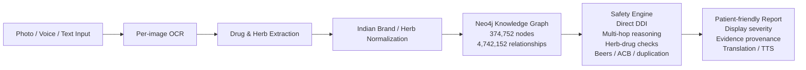

<h1 align="center">JeevanaRAG</h1>

<p align="center"><strong>A graph-powered, AI-augmented medication safety platform designed for elderly patients across India.</strong></p>

<p align="center">
  Snap a photo of your prescriptions, and JeevanaRAG identifies Indian brand-name medicines and Ayurvedic herbs,
  uncovers both obvious and hidden drug interactions, and delivers clear safety guidance in everyday language.
</p>

<p align="center">
  <a href="https://drive.google.com/file/d/1flDrBc4azwtw6EeM76nGWD4jQp2GkK5x/view?usp=drivesdk">Watch 2-Min Demo</a>
  ·
  <a href="https://drive.google.com/file/d/1gquj4NYOrq74wG2DNj3Sqbq6spR4T5Ta/view?usp=drive_link">Download Android APK</a>
  ·
  <a href="./docs/JEEVANARAG_COMPLETE_EXPLAINER.md">Full Technical Explainer</a>
  ·
  <a href="#run-locally">Run Locally</a>
</p>

## The Problem We Set Out to Solve

JeevanaRAG was created to address a gap we believe most off-the-shelf medication checkers fail to close in the Indian healthcare landscape:

- Elderly patients routinely consume 5–10 medications prescribed by multiple specialists
- Prescriptions are written using Indian commercial brand names rather than international generic identifiers
- A significant number of patients simultaneously use Ayurvedic herbal supplements that conventional tools overlook entirely
- Many dangerous interactions are indirect — routed through shared liver enzymes or electrolyte pathways — rather than a simple Drug A vs Drug B conflict
- Safety reports must be comprehensible to patients and caregivers, not just medical professionals

Our system therefore tackles the entire pipeline from end to end:

- Individual-image OCR processing for prescriptions and medicine strips
- Indian brand and herbal supplement resolution into canonical drug identifiers
- Graph-driven direct and multi-hop safety analysis
- Geriatric-specific Beers screening coupled with anticholinergic burden assessment
- Multilingual, patient-readable report generation with full evidence provenance

Consider a typical real-world scenario the system handles:

`Ecosprin 75 + Warf 5 + Garlic`

JeevanaRAG maps the Indian brand to `aspirin`, flags the bleeding interaction with `warfarin`, layers in the herbal risk from `garlic`, and translates that into a plain-language actionable warning.

## Why This Architecture

| Challenge | Significance |
|---|---|
| Indian brand-name prescriptions | Real patients say `Ecosprin`, `Dolo 650`, `Thyronorm` — not `aspirin` or `paracetamol` |
| Herb-drug interaction coverage | Elderly Indians frequently combine allopathic drugs with Ayurvedic supplements |
| Hidden mechanism-based interactions | Critical risks can propagate through CYP enzymes, membrane transporters, QT intervals, electrolyte imbalances, or CNS depression stacking |
| Elderly-focused safety screening | Pairwise DDI checking alone misses Beers-listed risks, cumulative burden scores, and therapeutic duplication |
| Trustworthy reporting | A patient-facing application cannot afford hallucinations or disconnected evidence trails |

## Implemented Capabilities

| Capability | Implementation Detail |
|---|---|
| Indian medicine comprehension | Resolves 249K+ Indian brand entries to underlying generics and active ingredients |
| Herbal supplement awareness | Validates curated Ayurvedic herb-drug interactions including regional-language herb names |
| Multi-hop reasoning | Identifies hidden risks via CYP inhibition/induction, transporter mediation, QT compounding, electrolyte cascades, and CNS depression stacking |
| Geriatric-first safety | Enforces Beers Criteria 2023, anticholinergic burden scoring, and therapeutic duplication detection |
| Provenance-aware reports | Maintains finding identity, evidence trails, citations, and patient-facing display severity throughout the pipeline |
| Transparent uncertainty | Unresolved direct-DDI severity is presented to patients as `Doctor Review` rather than raw `UNKNOWN` |

## Validation Overview

| Metric | Result |
|---|---:|
| Critical sentinel interactions validated | 50 / 50 |
| Real-world graph validation checks passed | 32 / 32 |
| Direct DDI sensitivity | 1.00 |
| Herb-drug sensitivity on curated set | 1.00 |
| Multi-hop graph path precision | 1.00 |
| Hallucinated findings in grounded evaluation | 0.00 |
| Backend P95 latency | 1338.51 ms |
| Live graph size | 374,752 nodes / 4,742,152 relationships / 37 types |
| Report provenance regression suite | 16 / 16 passed |

Detailed methodology and results are documented in [JEEVANARAG_COMPLETE_EXPLAINER.md](./docs/JEEVANARAG_COMPLETE_EXPLAINER.md).

## End-to-End Architecture



## User Journey

1. The patient or caregiver selects a preferred language and captures medicine images.
2. JeevanaRAG processes OCR on each image individually rather than concatenating all text into a single blob.
3. Detected medicines are normalized from Indian brand names into canonical drugs and active ingredients.
4. Failed or questionable predictions are routed to a unified manual review queue instead of being silently discarded.
5. The backend executes direct DDI, multi-hop, herb-drug, Beers, ACB, and duplication checks.
6. A patient-friendly report is generated with evidence correctly attributed to each finding.

## Technology Stack

| Layer | Technologies |
|---|---|
| Mobile app | Expo 54, React Native 0.81, React 19, Expo Router, NativeWind, Zustand |
| Web frontend | Next.js 16.2, React 19.2, Tailwind CSS 4, Base UI |
| Backend | FastAPI, Pydantic 2, LangGraph, LangChain, Neo4j 5 |
| AI services | GPT-4o Vision, Gemini 2.0 Flash, Groq Llama Vision/Text, Sarvam AI, RxNorm API |
| Data backbone | DDInter, DDID, PrimeKG, Hetionet, SIDER, OnSIDES, TwoSIDES, Indian medicine dataset, FDA NDC, curated herbs, Beers 2023, CYP expansion |
| Deployment | Docker Compose local stack, RunPod-ready backend path |

## Why the Backend Depth Matters

This project was deliberately engineered to be more than a polished mobile demo:

- The local Docker stack now serves the complete knowledge graph, not a trimmed showcase subset
- OCR, extraction, normalization, graph reasoning, and report generation are connected in a single working pipeline
- Report generation is constrained by graph-backed findings rather than unconstrained model output
- The live pipeline preserves finding identity, citations, evidence profiles, and patient-facing display severity

That backend rigor is what gives the mobile experience clinical credibility.

## Demo and Downloads

- Demo video: [2-minute app walkthrough](https://drive.google.com/file/d/1flDrBc4azwtw6EeM76nGWD4jQp2GkK5x/view?usp=drivesdk)
- Android APK: [Download from Drive](https://drive.google.com/file/d/1gquj4NYOrq74wG2DNj3Sqbq6spR4T5Ta/view?usp=drive_link)
- Full technical explainer: [JEEVANARAG_COMPLETE_EXPLAINER.md](./docs/JEEVANARAG_COMPLETE_EXPLAINER.md)

## Run Locally

<details>
<summary>Docker quickstart</summary>

```bash
cd jeevanarag
cp .env.example .env
# Fill in required API keys and Neo4j password

docker compose up --build -d
curl http://localhost:8000/healthz
```

Expected health response:

```json
{"status":"ok","service":"JEEVANARAG","neo4j":true,"graph_nodes":374752}
```

Neo4j Browser:

```bash
open http://localhost:7474
```

</details>

<details>
<summary>Developer notes</summary>

- Backend API: [`app/api/server.py`](./app/api/server.py)
- OCR logic: [`app/services/ocr_service.py`](./app/services/ocr_service.py)
- Drug normalization: [`app/services/drug_normalizer.py`](./app/services/drug_normalizer.py)
- Core safety engine: [`app/services/agentic_safety_checker.py`](./app/services/agentic_safety_checker.py)
- Report generation: [`app/services/report_generator.py`](./app/services/report_generator.py)
- Graph query layer: [`app/graph/query_engine.py`](./app/graph/query_engine.py)
- Evaluation and regression tests: [`tests`](./tests)

</details>

<details>
<summary>Repository layout</summary>

```text
jeevanarag/
├── app/                              # FastAPI app, graph logic, services, data
├── mobile/                           # Expo / React Native mobile experience
├── frontend/                         # Next.js web frontend
├── tests/                            # Regression and evaluation tests
├── scripts/                          # Build, evaluation, repair, and smoke-test scripts
├── docker-compose.yml                # Local full-stack orchestration
├── docs/                             # Deep technical notes and evaluation docs
└── README.md                         # Project overview, proof, and quick start
```

</details>

## Deep Technical Documentation

The complete story — system design rationale, graph construction process, evaluation methodology, and candid limitations — is available in [JEEVANARAG_COMPLETE_EXPLAINER.md](./docs/JEEVANARAG_COMPLETE_EXPLAINER.md).

It covers:

- the 12 data layers powering the knowledge graph
- the full medication-to-report processing pipeline
- how multi-hop interaction reasoning operates
- where LLMs are employed and where they are deliberately constrained
- what the evaluation results demonstrate and what they do not
